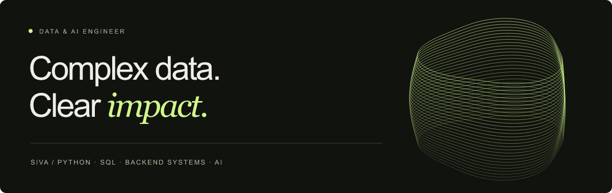

<p align="center">
  
</p>

<p align="center">
  <a href="https://balasivasaimegireddypadala.netlify.app/"><strong>Portfolio ↗</strong></a> &nbsp; · &nbsp;
  <a href="https://www.linkedin.com/in/bala-siva-sai-megi-reddy-padala/">LinkedIn</a> &nbsp; · &nbsp;
  <a href="https://github.com/siva-fy?tab=repositories&amp;q=archived%3Afalse">Active repositories</a>
</p>

## Hi, I'm Siva.

I'm **Padala Bala Siva Sai Megi Reddy**, a **Data & AI Engineer** based in India.
I'm interested in reliable data pipelines, useful backend systems, and the
engineering that makes AI applications measurable.

My personal projects explore a connected set of questions: **Can the pipeline
survive a replay? Can the data be trusted? Can the AI result be evaluated?**

## Start here

Explore **[Event Warehouse](https://github.com/siva-fy/event-warehouse)** for a
small, replay-safe data pipeline, or **[Retrieval Eval Lab](https://github.com/siva-fy/retrieval-eval-lab)**
for an inspectable retrieval baseline. Both run locally with synthetic fixtures:

```bash
git clone https://github.com/siva-fy/event-warehouse.git
cd event-warehouse
python3 demo.py
python3 -m unittest discover -s tests -v
```

## Data engineering

| Project | What you can inspect |
| :--- | :--- |
| **[Event Warehouse](https://github.com/siva-fy/event-warehouse)** | JSONL → raw ledger → validated payments → SQL revenue mart. Deduplication, quarantine, UTC normalization and currency isolation. |
| **[CDC Replay Engine](https://github.com/siva-fy/cdc-replay-engine)** | Versioned changes, out-of-order updates, tombstones, collision detection and transactional replay. |
| **[Data Contract Guard](https://github.com/siva-fy/data-contract-guard)** | CSV contracts, schema drift, uniqueness, freshness checks and a command-line quality gate. |

## AI engineering & data for AI

| Project | What you can inspect |
| :--- | :--- |
| **[Retrieval Eval Lab](https://github.com/siva-fy/retrieval-eval-lab)** | BM25 vs. keyword overlap, paragraph citations, recall@k, MRR and an abstention baseline. |
| **[LLM Output Evaluator](https://github.com/siva-fy/llm-output-evaluator)** | Offline checks for structured responses, citations, abstention, regression coverage, latency and cost estimates. |
| **[Point-in-Time Features](https://github.com/siva-fy/point-in-time-features)** | Historical SQL features that respect event time and data availability to prevent temporal leakage. |

**Try any of these locally:** clone the repository, then run `python3 demo.py`.
Each includes synthetic fixtures, tests, CI, architecture notes and documented
tradeoffs. These are **AI-assisted learning and reference projects**; their demo
results are reproducible fixture outputs, not production or model benchmarks.

## Earlier explorations

These older projects show my path through ETL, machine learning, web and mobile
development. Their READMEs explain setup and current limitations.

- [Banking ETL](https://github.com/siva-fy/ETL-Banks-Project) — extraction, transformation and CSV/SQL outputs.
- [Transformer from scratch](https://github.com/siva-fy/Language_translation_using_Transformer_from_scratch) — an encoder–decoder language translation project.
- [Book Store](https://github.com/siva-fy/Book-Store-Mern-Stack) — React, Express and MongoDB.
- [Flutter Weather](https://github.com/siva-fy/FlutterWeather) — a mobile weather application.

Smaller coursework and interface exercises live in the
[learning archive](https://github.com/siva-fy?tab=repositories&q=archived%3Atrue).

## What I work with here

**Data & systems:** Python · SQL · SQLite · data modeling · ETL · validation  
**AI foundations:** retrieval · evaluation · NLP · TensorFlow · PyTorch  
**Applications:** JavaScript · React · Node.js · Express · GitHub Actions

I like making failure paths visible, keeping examples reproducible, and learning
the fundamentals behind the abstractions.

---

Have an interesting data problem or an idea worth building?
**[Let's connect.](https://www.linkedin.com/in/bala-siva-sai-megi-reddy-padala/)**
